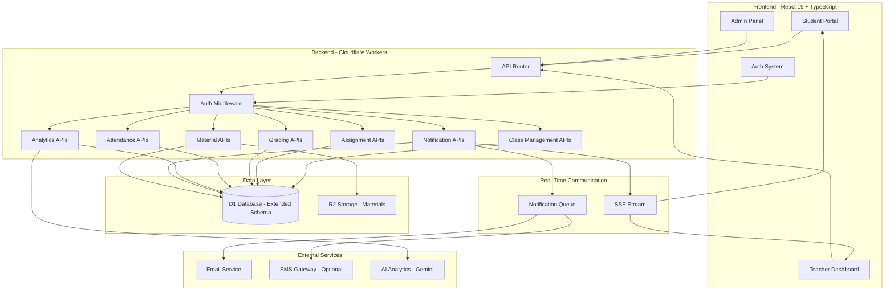
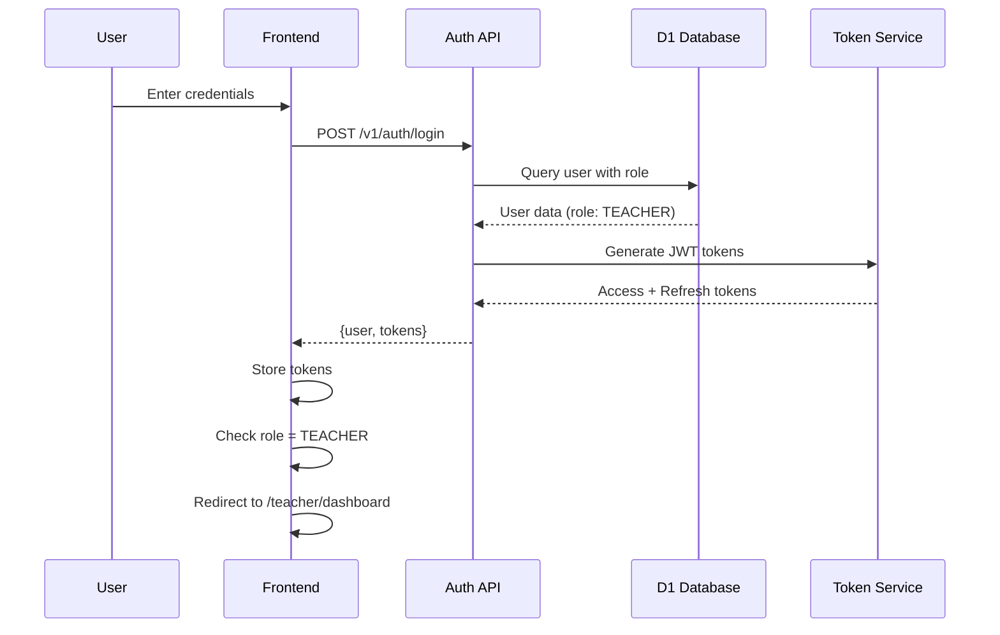
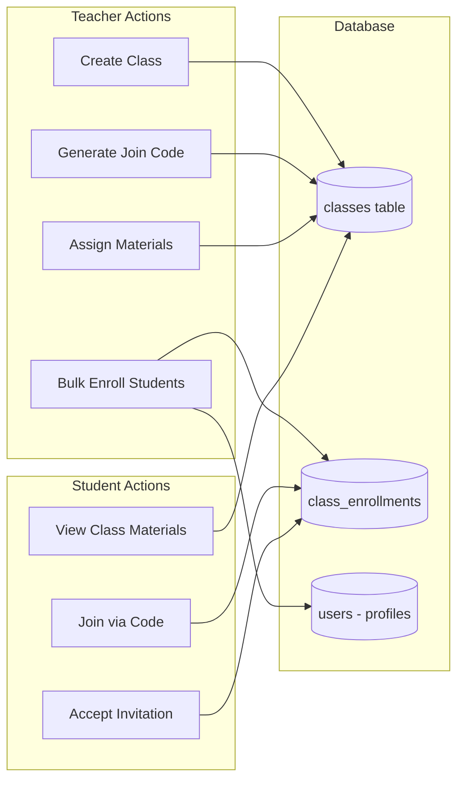
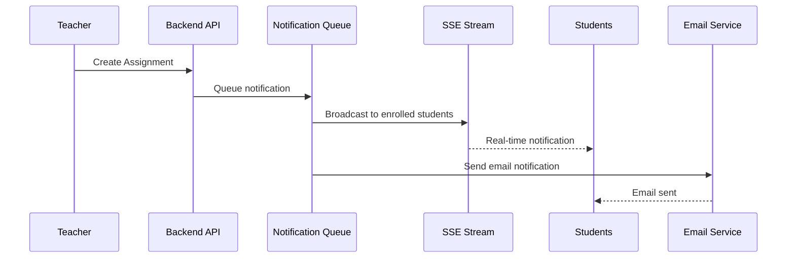

# Design Document: Teacher Dashboard Integration

## Overview

The Teacher Dashboard Integration feature extends the existing ShikshaSahayak Student Assessment Platform by adding a comprehensive teacher-facing interface. This integration enables teachers to manage classrooms, create and grade assessments, track student performance, manage attendance, upload study materials, and communicate with students in real-time. The system will be built as a unified platform sharing the existing authentication infrastructure (custom JWT with Firebase ID tokens), Cloudflare Workers backend, D1 database (extending schema-assessment.sql), and R2 storage.

This design leverages the existing role-based authentication system which already includes TEACHER as a role. Teachers will be automatically routed to their dashboard upon login, while students continue accessing the student portal. The architecture emphasizes real-time synchronization using Server-Sent Events (SSE), ensuring that teacher actions (assignment creation, grading, announcements) are immediately reflected in the student interface.

The system introduces a three-tier teacher hierarchy (HOD, Course Coordinators, Regular Teachers) with appropriate permissions, AI-powered analytics for identifying at-risk students, and multi-channel communication (in-app notifications, email, optional SMS). The design extends the existing database schema with 12 new tables while maintaining backward compatibility with the current student assessment features.

## Architecture

### High-Level System Architecture



### Authentication Flow



### Class and Enrollment Architecture



### Real-Time Notification Architecture



## Components and Interfaces

### Component 1: TeacherRoute Guard

**Purpose**: Protect teacher-only routes and auto-redirect based on role

**Interface**:
```typescript
interface TeacherRouteProps {
  children: React.ReactNode;
  requiredHierarchy?: 'HOD' | 'COURSE_COORDINATOR' | 'TEACHER';
}
```

**Responsibilities**:
- Check if user is authenticated
- Verify user role is TEACHER
- Check teacher hierarchy level if specified
- Redirect non-teachers to appropriate dashboard
- Render protected content for authorized teachers


### Component 2: ClassManagementService

**Purpose**: Handle all class-related operations including creation, enrollment, and management

**Interface**:
```typescript
interface ClassManagementService {
  createClass(data: CreateClassDTO): Promise<Class>;
  updateClass(classId: string, data: UpdateClassDTO): Promise<Class>;
  deleteClass(classId: string): Promise<void>;
  getTeacherClasses(teacherId: string): Promise<Class[]>;
  generateJoinCode(classId: string): Promise<string>;
  bulkEnrollStudents(classId: string, enrollmentNumbers: string[]): Promise<EnrollmentResult>;
  removeStudent(classId: string, studentId: string): Promise<void>;
  getClassDetails(classId: string): Promise<ClassDetail>;
  getClassAnalytics(classId: string): Promise<ClassAnalytics>;
}
```

**Responsibilities**:
- Create and manage class entities
- Generate unique join codes
- Handle bulk student enrollment with placeholder creation
- Track class statistics and analytics
- Manage class materials assignments

### Component 3: GradingEngine

**Purpose**: Automate grading for objective questions and facilitate manual grading for subjective content

**Interface**:
```typescript
interface GradingEngine {
  autoGradeQuiz(attemptId: string): Promise<GradingResult>;
  autoGradeAssignment(submissionId: string): Promise<GradingResult>;
  manualGradeSubmission(submissionId: string, marks: number, feedback: string): Promise<void>;
  overrideGrade(submissionId: string, newMarks: number, reason: string): Promise<void>;
  applyRubric(submissionId: string, rubricScores: RubricScore[]): Promise<GradingResult>;
  releaseGrades(assignmentId: string): Promise<void>;
  getGradingQueue(teacherId: string): Promise<PendingSubmission[]>;
}
```

**Responsibilities**:
- Automatically grade multiple-choice questions
- Support manual grading workflow for subjective answers
- Apply grading rubrics consistently
- Allow grade overrides with audit trail
- Batch release grades to students


### Component 4: AttendanceManager

**Purpose**: Record and track student attendance across class sessions

**Interface**:
```typescript
interface AttendanceManager {
  recordAttendance(classId: string, date: string, records: AttendanceRecord[]): Promise<void>;
  markPresent(classId: string, studentId: string, date: string): Promise<void>;
  markAbsent(classId: string, studentId: string, date: string): Promise<void>;
  getAttendanceReport(classId: string, startDate: string, endDate: string): Promise<AttendanceReport>;
  getStudentAttendance(studentId: string, classId: string): Promise<StudentAttendanceStats>;
  exportAttendanceCSV(classId: string, startDate: string, endDate: string): Promise<string>;
  identifyAtRiskStudents(classId: string, threshold: number): Promise<Student[]>;
}
```

**Responsibilities**:
- Record daily attendance for class sessions
- Generate attendance reports by date range
- Calculate attendance percentages per student
- Identify students below attendance thresholds
- Export attendance data for administrative use

### Component 5: NotificationService

**Purpose**: Manage multi-channel notifications (in-app, email, SMS)

**Interface**:
```typescript
interface NotificationService {
  sendNotification(notification: NotificationDTO): Promise<void>;
  sendBulkNotifications(notifications: NotificationDTO[]): Promise<void>;
  subscribeToStream(userId: string): ReadableStream;
  markAsRead(notificationId: string): Promise<void>;
  getUserNotifications(userId: string, unreadOnly: boolean): Promise<Notification[]>;
  sendEmail(to: string[], subject: string, body: string): Promise<void>;
  sendSMS(to: string[], message: string): Promise<void>;
}
```

**Responsibilities**:
- Queue and send notifications across channels
- Maintain SSE connections for real-time updates
- Track read/unread status
- Support bulk notification operations
- Integrate with external email and SMS services


### Component 6: AnalyticsDashboard

**Purpose**: Provide comprehensive analytics and insights for teachers

**Interface**:
```typescript
interface AnalyticsDashboard {
  getTeacherOverview(teacherId: string): Promise<TeacherDashboardStats>;
  getClassPerformance(classId: string): Promise<ClassPerformanceMetrics>;
  getStudentAnalytics(studentId: string, classId: string): Promise<StudentAnalytics>;
  getQuizAnalytics(quizId: string): Promise<QuizAnalytics>;
  getAssignmentAnalytics(assignmentId: string): Promise<AssignmentAnalytics>;
  identifyAtRiskStudents(classId: string): Promise<AtRiskStudent[]>;
  generateAIInsights(classId: string): Promise<AIInsight[]>;
  exportAnalyticsReport(classId: string, format: 'PDF' | 'CSV'): Promise<string>;
}
```

**Responsibilities**:
- Aggregate class and student performance data
- Calculate statistical metrics (averages, distributions)
- Identify struggling students using threshold analysis
- Generate AI-powered insights using Gemini API
- Export comprehensive analytics reports

### Component 7: MaterialsManager

**Purpose**: Handle upload, storage, and distribution of study materials

**Interface**:
```typescript
interface MaterialsManager {
  uploadMaterial(file: File, metadata: MaterialMetadata): Promise<Material>;
  updateMaterial(materialId: string, updates: Partial<MaterialMetadata>): Promise<Material>;
  deleteMaterial(materialId: string): Promise<void>;
  assignToClass(materialId: string, classId: string): Promise<void>;
  unassignFromClass(materialId: string, classId: string): Promise<void>;
  setVisibility(materialId: string, isVisible: boolean): Promise<void>;
  getMaterialsByClass(classId: string): Promise<Material[]>;
  trackMaterialView(materialId: string, userId: string): Promise<void>;
  getMaterialStats(materialId: string): Promise<MaterialStats>;
}
```

**Responsibilities**:
- Upload materials to R2 storage with version control
- Manage material metadata and visibility
- Assign/unassign materials to specific classes
- Track student access and download statistics
- Support multiple file types (PDF, documents, videos)


## Data Models

### Model 1: Class

```typescript
interface Class {
  id: string;
  teacher_id: string;
  subject_id: string | null;
  name: string;
  description: string | null;
  section: string | null;
  semester: number | null;
  academic_year: string | null;
  join_code: string;
  grading_system: 'PERCENTAGE' | 'GPA' | 'LETTER' | 'PASS_FAIL';
  max_students: number;
  is_active: boolean;
  cover_image: string | null;
  created_at: string;
  updated_at: string;
}
```

**Validation Rules**:
- `name` must be non-empty and max 200 characters
- `join_code` must be unique across all active classes
- `semester` must be between 1 and 12 if provided
- `academic_year` must follow format "YYYY-YY" (e.g., "2024-25")
- `max_students` must be positive integer
- `grading_system` must be one of the enum values

### Model 2: ClassEnrollment

```typescript
interface ClassEnrollment {
  id: string;
  class_id: string;
  student_id: string;
  enrollment_number: string | null;
  enrollment_status: 'ACTIVE' | 'PENDING' | 'WITHDRAWN' | 'COMPLETED';
  enrolled_at: string;
  withdrawn_at: string | null;
  final_grade: string | null;
  is_placeholder: boolean;
  invitation_sent_at: string | null;
  invitation_accepted_at: string | null;
}
```

**Validation Rules**:
- Unique constraint on (`class_id`, `student_id`)
- Unique constraint on (`class_id`, `enrollment_number`) when not null
- `enrollment_status` must be one of the enum values
- `is_placeholder` indicates if account was auto-created
- `final_grade` can only be set when status is 'COMPLETED'


### Model 3: Assignment

```typescript
interface Assignment {
  id: string;
  class_id: string;
  title: string;
  description: string | null;
  instructions: string | null;
  status: 'DRAFT' | 'PUBLISHED' | 'CLOSED' | 'GRADED';
  total_marks: number;
  due_date: string;
  published_at: string | null;
  allow_late_submission: boolean;
  late_penalty_percent: number | null;
  max_file_size_mb: number | null;
  allowed_file_types: string; // JSON array
  rubric: string | null; // JSON object
  attachments: string | null; // JSON array
  created_by: string;
  created_at: string;
  updated_at: string;
}
```

**Validation Rules**:
- `title` must be non-empty and max 300 characters
- `total_marks` must be positive
- `due_date` must be in ISO 8601 format
- `late_penalty_percent` must be between 0 and 100
- `max_file_size_mb` must be positive
- `allowed_file_types` must be valid JSON array of MIME types
- `rubric` must be valid JSON object if provided

### Model 4: AssignmentSubmission

```typescript
interface AssignmentSubmission {
  id: string;
  assignment_id: string;
  student_id: string;
  status: 'PENDING' | 'SUBMITTED' | 'LATE_SUBMITTED' | 'GRADED' | 'RETURNED' | 'RESUBMITTED';
  text_content: string | null;
  attachments: string | null; // JSON array
  external_links: string | null; // JSON array
  submitted_at: string | null;
  graded_at: string | null;
  graded_by: string | null;
  marks: number | null;
  feedback: string | null;
  annotations: string | null; // JSON object
  is_late: boolean;
  resubmit_count: number;
  created_at: string;
  updated_at: string;
}
```

**Validation Rules**:
- Unique constraint on (`assignment_id`, `student_id`, `resubmit_count`)
- `marks` must be <= assignment total_marks
- `is_late` is true if submitted_at > assignment due_date
- `graded_by` must reference a valid teacher user
- `status` must progress logically (PENDING -> SUBMITTED -> GRADED)


### Model 5: AttendanceRecord

```typescript
interface AttendanceRecord {
  id: string;
  class_id: string;
  student_id: string;
  date: string; // YYYY-MM-DD
  status: 'PRESENT' | 'ABSENT' | 'LATE' | 'EXCUSED';
  notes: string | null;
  recorded_by: string;
  recorded_at: string;
}
```

**Validation Rules**:
- Unique constraint on (`class_id`, `student_id`, `date`)
- `date` must be in YYYY-MM-DD format
- `status` must be one of the enum values
- `recorded_by` must reference a valid teacher user

### Model 6: ClassMaterial

```typescript
interface ClassMaterial {
  id: string;
  class_id: string;
  title: string;
  description: string | null;
  file_url: string;
  file_name: string;
  file_type: string;
  file_size_bytes: number | null;
  is_visible: boolean;
  uploaded_by: string;
  created_at: string;
  updated_at: string;
}
```

**Validation Rules**:
- `title` must be non-empty and max 300 characters
- `file_url` must be valid R2 object URL
- `file_type` must be valid MIME type
- `is_visible` controls student access
- `uploaded_by` must reference a valid teacher user

### Model 7: Notification

```typescript
interface Notification {
  id: string;
  user_id: string;
  type: NotificationType;
  channel: 'IN_APP' | 'EMAIL' | 'SMS';
  title: string;
  message: string;
  link: string | null;
  metadata: string | null; // JSON object
  is_read: boolean;
  read_at: string | null;
  created_at: string;
}
```

**Validation Rules**:
- `type` must be one of NotificationType enum
- `channel` must be one of the enum values
- `title` must be non-empty and max 200 characters
- `message` must be non-empty and max 1000 characters
- `is_read` defaults to false
- `read_at` is null until marked as read


### Model 8: TeacherDepartment

```typescript
interface TeacherDepartment {
  id: string;
  teacher_id: string;
  department_id: string;
  hierarchy: 'HOD' | 'COURSE_COORDINATOR' | 'TEACHER';
  assigned_at: string;
  is_primary: boolean;
}
```

**Validation Rules**:
- Unique constraint on (`teacher_id`, `department_id`)
- Only one primary department per teacher (`is_primary` = true)
- `hierarchy` determines permission level
- HOD has highest permissions, followed by COURSE_COORDINATOR, then TEACHER

### Model 9: QuizClassAssignment

```typescript
interface QuizClassAssignment {
  id: string;
  quiz_id: string;
  class_id: string;
  assigned_at: string;
  is_visible: boolean;
}
```

**Validation Rules**:
- Unique constraint on (`quiz_id`, `class_id`)
- `is_visible` controls student access
- Foreign keys must reference existing quiz and class

### Model 10: MaterialStats

```typescript
interface MaterialStats {
  id: string;
  material_id: string;
  student_id: string;
  viewed_at: string;
  download_count: number;
  last_accessed: string;
}
```

**Validation Rules**:
- Unique constraint on (`material_id`, `student_id`)
- `download_count` defaults to 0
- `last_accessed` updates on each view
- Tracks engagement with study materials


## Error Handling

### Error Scenario 1: Duplicate Enrollment

**Condition**: When attempting to enroll a student already enrolled in a class
**Response**: Return HTTP 409 Conflict with error message "Student already enrolled in this class"
**Recovery**: Check enrollment status before retry; if WITHDRAWN, allow re-enrollment

### Error Scenario 2: Invalid Join Code

**Condition**: When a student attempts to join using an invalid or expired join code
**Response**: Return HTTP 404 Not Found with error message "Invalid join code"
**Recovery**: Teacher regenerates join code; student uses new code

### Error Scenario 3: Bulk Enrollment Partial Failure

**Condition**: When some enrollment numbers in bulk operation are invalid or already exist
**Response**: Return HTTP 207 Multi-Status with list of successful and failed enrollments
**Recovery**: Teacher reviews failed enrollments and corrects enrollment numbers; retry failed entries

### Error Scenario 4: Grade Override Without Permission

**Condition**: When a non-HOD teacher attempts to override another teacher's grades
**Response**: Return HTTP 403 Forbidden with error message "Insufficient permissions to override grades"
**Recovery**: Request HOD or Course Coordinator to perform the override

### Error Scenario 5: Assignment Past Due Date

**Condition**: When a student attempts to submit after due date and late submissions are disabled
**Response**: Return HTTP 403 Forbidden with error message "Assignment past due date. Late submissions not allowed"
**Recovery**: Student contacts teacher; teacher may enable late submissions or extend due date

### Error Scenario 6: SSE Connection Loss

**Condition**: When real-time notification stream is interrupted
**Response**: Client automatically attempts reconnection with exponential backoff
**Recovery**: Client re-establishes SSE connection; server sends missed notifications; client updates UI


### Error Scenario 7: File Upload Size Exceeded

**Condition**: When uploaded file exceeds max_file_size_mb limit
**Response**: Return HTTP 413 Payload Too Large with error message "File size exceeds {limit}MB"
**Recovery**: User compresses file or splits into multiple files; retry upload

### Error Scenario 8: Concurrent Grade Modification

**Condition**: When two teachers attempt to grade the same submission simultaneously
**Response**: Use optimistic locking with version field; return HTTP 409 Conflict for second attempt
**Recovery**: Second teacher refreshes submission data and reapplies grading

## Testing Strategy

### Unit Testing Approach

**Focus Areas**:
- Authentication and authorization logic (role-based routing, permission checks)
- Data validation functions (enrollment number format, grade boundaries, date validation)
- Grading engine calculations (score computation, rubric application, penalty calculation)
- Notification formatting and channel selection
- Analytics aggregation functions

**Key Test Cases**:
- TeacherRoute: Redirects non-teachers to student dashboard
- BulkEnrollment: Creates placeholder accounts for unregistered enrollment numbers
- AutoGrading: Correctly scores MCQ quizzes with negative marking
- AttendanceCalculation: Computes correct attendance percentages
- JoinCodeGeneration: Produces unique, collision-free codes

**Coverage Goals**: Minimum 80% code coverage for business logic; 100% for authentication/authorization

### Property-Based Testing Approach

This feature is not suitable for extensive property-based testing as it primarily involves:
- Database CRUD operations with specific business rules
- UI rendering and user interaction
- Integration with external services (email, SMS)
- Real-time communication via SSE

Property-based testing is not appropriate for infrastructure, UI rendering, or side-effect operations. Testing will rely on unit tests and integration tests.


### Integration Testing Approach

**Test Scenarios**:
1. **End-to-End Class Creation**: Teacher creates class → Students join via code → Materials assigned → Notifications received
2. **Assignment Lifecycle**: Teacher creates assignment → Students submit → Auto-grading executes → Manual grading → Grades released → Students notified
3. **Attendance Flow**: Teacher records attendance → System calculates percentages → At-risk alerts triggered → Reports generated
4. **Real-time Sync**: Teacher action in one session → SSE event broadcast → Multiple student sessions updated simultaneously
5. **Bulk Enrollment**: Teacher uploads CSV → System validates → Placeholder accounts created → Invitation emails sent → Students accept invitations

**Integration Points**:
- Frontend ↔ Cloudflare Workers API
- Workers ↔ D1 Database (transactional operations)
- Workers ↔ R2 Storage (file uploads/downloads)
- Workers ↔ Email service (transactional emails)
- SSE stream ↔ Multiple client connections
- Gemini API ↔ Analytics engine (AI insights)

**Test Data**:
- Mock teacher accounts with different hierarchy levels
- Mock student accounts with various enrollment statuses
- Sample classes with varying sizes and configurations
- Test assignments with different question types
- Historical attendance and performance data

## Performance Considerations

**Database Query Optimization**:
- Indexed queries on frequently accessed columns (class_id, student_id, teacher_id)
- Pagination for large result sets (class lists, student lists)
- Denormalized student_count and assignment_count in classes table
- Batch operations for bulk enrollment and notification sending

**SSE Connection Management**:
- Connection pooling with automatic reconnection
- Heartbeat mechanism to detect stale connections
- Maximum 1000 concurrent SSE connections per Worker
- Message buffering for disconnected clients


**Caching Strategy**:
- Cache class metadata and teacher profiles in memory (5-minute TTL)
- Cache frequently accessed analytics (dashboard stats) with 15-minute TTL
- Invalidate cache on relevant mutations (class updates, grade changes)
- Use Cloudflare KV for long-lived cached data (subject lists, department info)

**File Upload Optimization**:
- Direct R2 upload using pre-signed URLs (bypass Workers)
- Client-side file compression before upload
- Chunked upload for files > 10MB
- Progress tracking with resumable uploads

**Expected Load**:
- 100-500 concurrent teachers
- 5,000-20,000 students
- 50-200 classes per teacher
- 20-50 assignments per class per semester
- 500-1,000 notifications per hour during peak times

**Performance Targets**:
- API response time: < 200ms for reads, < 500ms for writes
- SSE notification delivery: < 1 second
- Dashboard load time: < 2 seconds
- File upload speed: 1-5 MB/s depending on network
- Analytics report generation: < 3 seconds

## Security Considerations

**Authentication & Authorization**:
- JWT-based authentication with 1-hour access token expiry
- Refresh token rotation with 7-day expiry
- Role-based access control (RBAC) enforced at API layer
- Teacher hierarchy permissions enforced for sensitive operations
- Route guards on frontend + middleware verification on backend

**Data Protection**:
- Student personal information (enrollment numbers, grades) encrypted at rest
- HTTPS-only communication (enforced by Cloudflare)
- Sensitive fields redacted in API logs
- PII anonymization in analytics exports


**Input Validation**:
- Server-side validation of all user inputs
- SQL injection prevention using parameterized queries
- XSS protection with input sanitization and output encoding
- File upload validation (type, size, content scanning)
- Rate limiting on sensitive endpoints (login, enrollment, notifications)

**Audit Trail**:
- Grade changes logged with timestamp, old value, new value, modifier
- Enrollment actions logged (additions, removals, status changes)
- Assignment modifications tracked
- Access logs for sensitive student data
- Audit records retained for 2 years

**File Security**:
- R2 objects stored with private access by default
- Pre-signed URLs with 1-hour expiry for authorized access
- Virus scanning for uploaded files (CloudFlare Zero Trust or third-party)
- File type validation based on content, not just extension
- Maximum file size limits enforced

**Notification Security**:
- Email verification before sending to student addresses
- SMS rate limiting to prevent abuse
- Notification content sanitized to prevent injection attacks
- Opt-out mechanism for non-critical notifications
- No sensitive data (grades, attendance) in email subject lines

## Correctness Properties

*A property is a characteristic or behavior that should hold true across all valid executions of a system-essentially, a formal statement about what the system should do. Properties serve as the bridge between human-readable specifications and machine-verifiable correctness guarantees.*

### Property 1: Join Code Uniqueness

*For any* two active classes created by the system, their join codes must be unique.

**Validates: Requirements 2.1**

### Property 2: Class Name Length Validation

*For any* class name input, the validation SHALL accept non-empty strings up to 200 characters and reject empty strings or strings exceeding 200 characters.

**Validates: Requirements 2.2**

### Property 3: Academic Year Format Validation

*For any* academic year input, the validation SHALL accept strings matching the format "YYYY-YY" (e.g., "2024-25") and reject all other formats.

**Validates: Requirements 2.3**

### Property 4: Semester Range Validation

*For any* semester input provided, the validation SHALL accept integers from 1 to 12 inclusive and reject values outside this range.

**Validates: Requirements 2.4**

### Property 5: Enrollment Uniqueness

*For any* class and student combination, attempting to create duplicate enrollments SHALL fail with the uniqueness constraint enforced.

**Validates: Requirements 3.7**

### Property 6: Enrollment Status Transition

*For any* active enrollment, when a teacher removes the student, the enrollment_status SHALL transition to WITHDRAWN.

**Validates: Requirements 3.9**

### Property 7: Assignment Title Validation

*For any* assignment title input, the validation SHALL accept non-empty strings up to 300 characters and reject empty strings or strings exceeding 300 characters.

**Validates: Requirements 4.1**

### Property 8: Total Marks Validation

*For any* assignment, the total_marks SHALL be a positive number greater than zero.

**Validates: Requirements 4.2**

### Property 9: Late Penalty Validation

*For any* late_penalty_percent provided, the value SHALL be between 0 and 100 inclusive.

**Validates: Requirements 4.4**

### Property 10: File Type Validation

*For any* file upload, when allowed_file_types are specified, the system SHALL reject files with MIME types not in the allowed list.

**Validates: Requirements 5.1**

### Property 11: File Size Enforcement

*For any* file upload, when max_file_size_mb is set, the system SHALL reject files exceeding this size limit.

**Validates: Requirements 5.2**

### Property 12: Late Submission Detection

*For any* submission, when submitted_at is after the assignment due_date, the is_late flag SHALL be set to true.

**Validates: Requirements 5.3**

### Property 13: Late Penalty Application

*For any* late submission with late_penalty_percent set, the final marks SHALL be reduced by the specified penalty percentage.

**Validates: Requirements 5.4**

### Property 14: MCQ Auto-Grading Accuracy

*For any* quiz containing only multiple-choice questions, the Grading_Engine SHALL calculate marks by comparing student answers to correct answers using the defined scoring rules.

**Validates: Requirements 6.1**

### Property 15: Marks Boundary Validation

*For any* submission being graded, the assigned marks SHALL not exceed the assignment's total_marks.

**Validates: Requirements 6.3**

### Property 16: Attendance Date Format Validation

*For any* attendance record, the date SHALL be validated to match YYYY-MM-DD format.

**Validates: Requirements 7.2**

### Property 17: Attendance Percentage Calculation

*For any* student in a class, the attendance percentage SHALL be calculated as (present_count / total_sessions) × 100.

**Validates: Requirements 7.4**

### Property 18: At-Risk Attendance Threshold

*For any* student, when attendance percentage falls below 75%, the system SHALL flag the student as at_risk.

**Validates: Requirements 10.4**

### Property 19: At-Risk Performance Threshold

*For any* student, when average assignment marks fall below 50%, the system SHALL flag the student as at_risk.

**Validates: Requirements 10.5**

### Property 20: Material Title Validation

*For any* material title input, the validation SHALL accept non-empty strings up to 300 characters and reject empty strings or strings exceeding 300 characters.

**Validates: Requirements 8.1**

### Property 21: Material Visibility Access Control

*For any* material with is_visible set to false, student access attempts SHALL be denied.

**Validates: Requirements 8.4**

### Property 22: Notification Title Validation

*For any* notification title input, the validation SHALL accept non-empty strings up to 200 characters and reject empty strings or strings exceeding 200 characters.

**Validates: Requirements 9.9**

### Property 23: Notification Message Validation

*For any* notification message input, the validation SHALL accept non-empty strings up to 1000 characters and reject empty strings or strings exceeding 1000 characters.

**Validates: Requirements 9.10**

### Property 24: Class Analytics Average Calculation

*For any* class with submitted assignments, the average marks SHALL be calculated as the sum of all marks divided by the number of submissions.

**Validates: Requirements 10.2**

### Property 25: Quiz Analytics Uniqueness

*For any* quiz and class combination, only one quiz_class_assignment record SHALL exist, enforcing the uniqueness constraint.

**Validates: Requirements 17.2**

### Property 26: Material Engagement Calculation

*For any* material assigned to a class, the engagement percentage SHALL be calculated as (students_viewed / total_enrolled) × 100.

**Validates: Requirements 18.5**

### Property 27: Rubric Total Validation

*For any* assignment with a defined rubric, the sum of all rubric criterion point values SHALL equal the assignment's total_marks.

**Validates: Requirements 19.3**

### Property 28: Parameterized Query Safety

*For all* database operations, the system SHALL use parameterized queries to prevent SQL injection, with no user input concatenated directly into SQL strings.

**Validates: Requirements 13.2**

### Property 29: Foreign Key Integrity

*For all* relationship operations (enrollment, submission, attendance), the system SHALL enforce foreign key constraints, rejecting references to non-existent entities.

**Validates: Requirements 13.4**

### Property 30: JSON Field Validation

*For any* field storing JSON data (rubric, allowed_file_types, attachments), the system SHALL validate that the input is well-formed JSON before storage.

**Validates: Requirements 13.7**

## Dependencies

**Frontend Dependencies**:
- React 19 (existing)
- TypeScript 5.x (existing)
- React Router v7 (existing)
- Tailwind CSS (existing)
- lucide-react (existing)
- Recharts (for analytics charts)
- React Query v5 (for data fetching and caching)
- date-fns (for date manipulation)

**Backend Dependencies**:
- Cloudflare Workers (existing runtime)
- Hono (existing routing framework)
- D1 Database (existing)
- R2 Storage (existing)
- @cloudflare/workers-types (TypeScript types)


**External Services**:
- Gemini API (AI analytics and insights)
  - Usage: Generate insights from student performance data
  - Rate limits: 60 requests/minute
  - Fallback: Skip AI insights if unavailable
  
- Email Service (Transactional emails)
  - Provider: CloudFlare Email Routing or SendGrid/Mailgun
  - Usage: Send invitation emails, notifications, reports
  - Rate limits: 1000 emails/hour
  
- SMS Gateway (Optional)
  - Provider: Twilio or similar
  - Usage: Urgent notifications and alerts
  - Rate limits: 100 SMS/hour
  - Configuration: Enable/disable per institution

**Database Extensions Required**:
- 12 new tables added to schema-assessment.sql
- Indexes on foreign keys and frequently queried columns
- Triggers for automatic timestamp updates
- Views for complex analytics queries

**Migration Strategy**:
- Schema changes applied via migration scripts
- Backward compatibility maintained for existing student features
- Zero downtime deployment using blue-green strategy
- Rollback plan for each migration

**Development Environment Setup**:
- Wrangler CLI for local Workers development
- Local D1 database for testing
- Local R2 bucket emulation
- Mock email/SMS services for testing
- Environment variables for API keys and configuration
