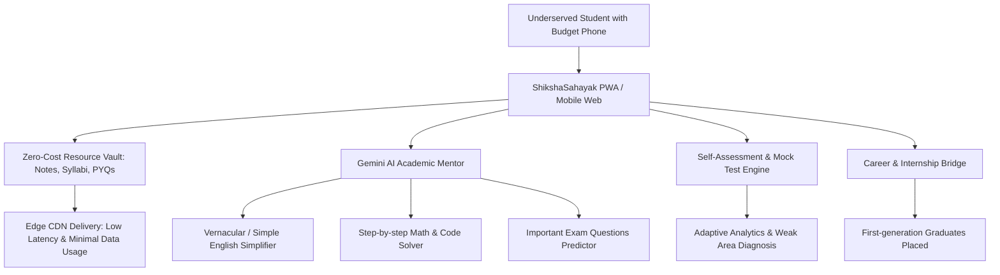

# 🏆 Hack for Social — Hackathon Idea Submission

**Project Title:** ShikshaSahayak — Democratizing Higher Education Through AI & Open Academic Ecosystems  
**Tagline:** *Empowering Every Student to Learn, Excel, and Rise — Irrespective of College, Location, or Language.*  
**Domain / Track:** Education for All / Digital Inclusion / AI for Social Good  
**UN Sustainable Development Goals (SDGs):**  
- **SDG 4:** Quality Education (Equal access to academic material & personalized tutoring)  
- **SDG 8:** Decent Work and Economic Growth (Career pathways & practical readiness)  
- **SDG 10:** Reduced Inequalities (Bridging the urban–rural & tier-1 vs. tier-3 education divide)

---

## 1. 📌 Executive Summary

Higher education in developing regions faces a severe inequality crisis: while tier-1 institutions have access to well-equipped libraries, modern labs, and expensive coaching, students in thousands of tier-2, tier-3, and rural colleges grapple with outdated syllabus delivery, fragmented study materials, high tuition/coaching paywalls, and English language comprehension barriers.

**ShikshaSahayak** is an open, mobile-first, AI-powered academic empowerment ecosystem. It combines:
1. **A Zero-Cost Academic Vault:** Verified lecture notes, Previous Year Questions (PYQs), solutions, and syllabus roadmaps.
2. **Context-Aware AI Mentorship:** Google Gemini–powered conceptual breakdowns, step-by-step problem solving, and exam pattern insights tailored specifically to university curriculums.
3. **Hyper-Accessible & Low-Bandwidth Architecture:** Deployed at the edge (Cloudflare Pages/Workers/R2) to run smoothly even on 3G/budget Android smartphones.
4. **Campus-to-Career Bridge:** Integrated mock assessments, skill tests, and curated entry-level internships/career listings to break student unemployment cycles.

---

## 2. 🚨 Problem Statement & The Ground Reality

### The Core Pain Points
1. **The Resource Divide (Information Asymmetry):**
   - High-quality handwritten notes, toppers' strategies, and solved past exam papers circulate in closed, isolated WhatsApp groups or are locked behind expensive subscription portals (e.g., Chegg, Scribd, StuDocu).
   - Millions of students across regional universities (like GTU, AKTU, VTU, etc.) spend hundreds of hours every semester hunting for basic syllabus copies and question papers.
2. **The "Language & Complexity" Wall:**
   - Textbooks are dense, written in complex formal English, and lack intuitive, real-world analogies. Students from vernacular or non-English medium backgrounds struggle to grasp foundational engineering and science concepts.
3. **Lack of Personalized Doubts Resolution:**
   - Student-to-professor ratios in regional colleges often exceed 60:1 or 100:1. College professors rarely have time for one-on-one doubt clearing, and private coaching is unaffordable for underprivileged families.
4. **High Semester Failure & Backlog Rates:**
   - Without targeted past question analysis (PYQs) and structured revision kits, students fall prey to exam panic and backlogs, which derail degrees and reduce employability.

---

## 3. 💡 Proposed Solution & Innovation

ShikshaSahayak is designed not as another static repository, but as an **active, intelligent academic companion** built around the real semester journey of a student:



### Key Pillars of Innovation:

| Pillar | How ShikshaSahayak Solves It |
| :--- | :--- |
| **1. Universal Access** | 100% free, no forced paywalls or predatory subscriptions. Open access to semester-wise notes, structured subject trees, and verified solutions. |
| **2. Contextual AI Tutor** | Rather than a generic chatbot that hallucinates, our Gemini-integrated AI is grounded in university curriculums and specific subjects to provide bite-sized summaries, code walkthroughs, and conceptual explanations. |
| **3. Mobile-First & Ultra-Lightweight** | Optimized for low-end mobile devices and flaky network connections using edge caching and lightweight Single Page Application (SPA) architecture. |
| **4. Active Recall & Self-Evaluation** | Flashcards, interactive chapter quizzes, and past-paper mock tests with automated scoring so students can test their readiness before final exams. |
| **5. Career & Opportunity Equalizer** | Job listings, internship alerts, and skills roadmap embedded right where students study, empowering them to transition smoothly from college to career. |

---

## 4. 👥 Target Beneficiaries & Social Impact

- **Primary Beneficiaries:**
  - 10M+ engineering, diploma, and undergraduate college students across Tier-2/Tier-3 cities and rural districts.
  - First-generation college attendees and economically weaker section (EWS) students who cannot afford ₹15,000–₹50,000 coaching classes.
  - Vernacular medium students who need simplified explanations in accessible language.
- **Measurable Metrics of Success:**
  - **Reduction in Study Prep Cost:** ₹0 spent on study notes and exam guidebooks.
  - **Academic Performance:** Estimated 20–30% drop in semester backlogs through targeted PYQ preparation.
  - **Time Saved:** Eliminating 15–20 hours per semester wasted hunting for syllabus-aligned materials.
  - **Digital Equity:** Equalizing resource availability between elite private universities and government/rural institutes.

---

## 5. 🛠️ Technical Architecture & Feasibility

ShikshaSahayak is built with an enterprise-grade, modern, and cost-efficient edge stack:

- **Frontend:** React 19, TypeScript, Tailwind CSS, Lucide Icons, Vite (Zero-bloat, lightning-fast rendering, responsive mobile UI).
- **Backend & Serverless APIs:** Cloudflare Workers (Globally distributed serverless functions running within 50ms of users).
- **Database & State:** Cloudflare D1 (Serverless SQLite at the edge) & Firebase for real-time authentication and user synchronization.
- **Media & File Storage:** Cloudflare R2 (High-capacity, zero-egress-fee object storage for PDFs, notes, and question paper scans).
- **Intelligent Layer:** Google Gemini AI API (`@google/genai`) for real-time concept simplification, summarization, and query resolution.
- **Cost Sustainability:** Thanks to Cloudflare's serverless edge tier and zero-egress R2 pricing, serving tens of thousands of students costs a fraction of traditional cloud VMs, ensuring long-term non-profit viability.

---

## 6. ⚔️ Competitive Analysis

| Dimension | ShikshaSahayak | Commercial Portals (Chegg / Scribd) | WhatsApp / Google Drive Groups |
| :--- | :--- | :--- | :--- |
| **Cost to Student** | **100% Free & Open** | Expensive Monthly Subscription ($15–$20/mo) | Free |
| **Curriculum Alignment** | **Tailored to State/University Boards (e.g. GTU)** | Generic International Content | Random & Unverified |
| **AI Doubt Clearing** | **Curriculum-Grounded Gemini AI** | Generic or Paywalled | None |
| **Searchability & UX** | **Instant search by Branch, Sem & Subject Code** | Complex / Paywall-gated | Chaotic, broken links & deleted files |
| **Career Readiness** | **Integrated internship & skill discovery** | None | None |

---

## 7. 🗺️ Implementation Roadmap

```
[Phase 1: Completed & Live]
  ├── Academic Repository (Notes, Syllabus, PYQs for core university branches)
  ├── Search & Categorization by Branch / Semester / Subject
  ├── Responsive Mobile & Desktop SPA
  └── Initial AI Summarization Engine with Gemini

[Phase 2: Hackathon Target / Next 3 Months]
  ├── Offline-First PWA (Caching downloaded notes for zero-data offline reading)
  ├── Multilingual / Regional Language Explanation (Hindi, Gujarati, Tamil, etc.)
  ├── Peer-Contribution & Student Mentor Badge System
  └── Interactive AI Mock Exam Generator from PYQ database

[Phase 3: Scale & Community Ecosystem]
  ├── College Ambassador Network across 100+ institutes
  ├── Direct College Placement & Micro-Internship Integration
  └── Audio-visual AI Flash Summaries for Auditory Learners
```

---

## 8. 🎤 10-Slide Pitch Deck Structure (Ready for Presentation)

If required to submit or present slides, follow this exact structure:

1. **Slide 1: Title Slide**
   - Title: *ShikshaSahayak*
   - Subtitle: *Democratizing Higher Education for Tier-2 & Tier-3 College Students*
   - Team Name & Members
2. **Slide 2: The Problem**
   - The silent crisis in regional colleges: Broken libraries, missing notes, unaffordable coaching, 30%+ semester backlog rates.
3. **Slide 3: The Gap**
   - Why Google Drive folders, WhatsApp groups, and paywalled platforms (Chegg/Scribd) fail regional students.
4. **Slide 4: Our Solution — ShikshaSahayak**
   - A single unified platform: Zero-cost academic vault + curriculum-grounded AI mentor + practice testing.
5. **Slide 5: Key Features & Demo Showcase**
   - Screenshots of: Branch/Semester Navigator, Instant PDF Viewer, AI Doubt Assistant, PYQ Hub.
6. **Slide 6: Social Impact & UN SDGs**
   - Direct alignment with SDG 4 (Quality Education) and SDG 10 (Reduced Inequalities). Real stories of students in rural colleges.
7. **Slide 7: Technology & Innovation**
   - React 19, Cloudflare Edge Network (D1, R2, Workers), Google Gemini AI integration. Built for low-bandwidth mobile.
8. **Slide 8: Feasibility & Unit Economics**
   - Zero-egress edge hosting costs = extreme sustainability. Open-source & community driven.
9. **Slide 9: Roadmap & Future Vision**
   - Offline-first PWA, regional vernacular voice summaries, and verified campus mentor networks.
10. **Slide 10: Conclusion & Call to Action**
    - *"Education is a fundamental right, not a luxury."* Join us in empowering the next million engineers and graduates!
