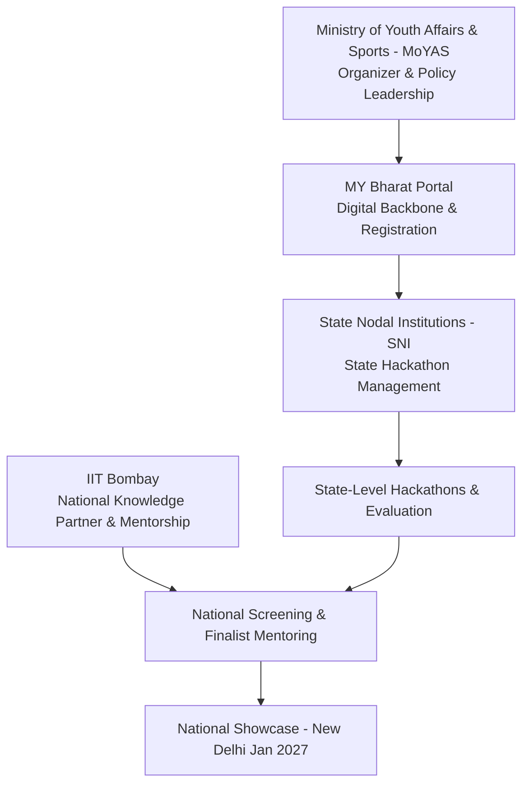

# 🇮🇳 Hack for Social Cause — VBYLD 2027
### *Comprehensive Hackathon Guide & Official Reference*

> **Vision:** *"Think Global, Hack Local — Technology for Social Transformation"*  
> **Mission:** Empower youth (aged 18–29) to engineer scalable, technology-driven solutions for social good, contributing to **Viksit Bharat 2047** and the **United Nations Sustainable Development Goals (UN SDGs)**.

---

## 📌 Table of Contents
1. [Overview & Purpose](#1-overview--purpose)
2. [Key Highlights & Eligibility](#2-key-highlights--eligibility)
3. [Partners & Governance Ecosystem](#3-partners--governance-ecosystem)
4. [Four-Stage Participation Roadmap](#4-four-stage-participation-roadmap)
5. [Themes & Indicative Problem Areas](#5-themes--indicative-problem-areas)
6. [Submission Deliverables Checklist](#6-submission-deliverables-checklist)
7. [Evaluation Matrix & Judging Criteria](#7-evaluation-matrix--judging-criteria)
8. [Intellectual Property (IP) & Open-Source Policy](#8-intellectual-property-ip--open-source-policy)
9. [Pro Tips for Hackathon Success](#9-pro-tips-for-hackathon-success)
10. [Team Action Plan & ShikshaSahayak Alignment](#10-team-action-plan--shikshasahayak-alignment)

---

## 1. Overview & Purpose

**Hack for Social Cause** is a flagship national initiative organized under the **Viksit Bharat Young Leaders Dialogue (VBYLD) 2027**.

- **Bridging Theory & Practice:** Designed to bridge the gap between classroom theoretical knowledge and real-world implementation by young innovators.
- **Societal Impact:** Fosters technology-enabled social innovation addressing hyper-local, regional, and national challenges.
- **National Trajectory:** Takes winning solutions from grassroots/state levels to national showcasing in New Delhi, receiving direct mentorship from institutions like IIT Bombay.

---

## 2. Key Highlights & Eligibility

| Parameter | Details |
| :--- | :--- |
| **Eligibility Age** | Youth aged **18 to 29 years** |
| **Target Audience** | Students, developers, young researchers, civic technologists, and grassroots innovators |
| **National Goal** | Meaningful contribution to **Viksit Bharat 2047** and **UN SDGs** |
| **Grand Finale** | National Showcasing in **New Delhi (January 2027)** |
| **Top Honors** | **Top 5 Teams** selected for national awards, incubation support, and national recognition |

---

## 3. Partners & Governance Ecosystem

The program operates under a multi-tier governance model connecting government, academia, state authorities, and grassroots youth:



### Institutional Roles

1. **Ministry of Youth Affairs & Sports (MoYAS)**
   - Organizer and overarching policy leadership.
   - Provides national platform, credentials, and inter-ministerial visibility for winning projects.
2. **IIT Bombay**
   - **National Knowledge Partner**.
   - Provides technical guidance, curriculum alignment, national-level screening, and rigorous mentoring for all national finalists.
3. **State Nodal Institutions (SNI)**
   - Manages state-level rounds, local jury evaluations, state mentoring bootcamps, and venue/logistical coordination.
4. **MY Bharat Portal**
   - Digital operational backbone powering team registrations, document verification, announcements, and program workflows.

---

## 4. Four-Stage Participation Roadmap

The competition progresses through four progressive screening filters from local to national acclaim:

```
┌────────────────────────────────────────────────────────┐
│ Stage 1: Registration & Submission of Idea             │
│ • Submit state-specific problem statement & proposal   │
│ • Upload slide deck, initial architecture, team KYC    │
└───────────────────────────┬────────────────────────────┘
                            │
                            ▼
┌────────────────────────────────────────────────────────┐
│ Stage 2: State-Level Hackathon                         │
│ • Hands-on prototyping & state jury evaluation        │
│ • Mentoring sessions by state experts                  │
│ • 🏆 Top 3 Teams per State/UT shortlisted              │
└───────────────────────────┬────────────────────────────┘
                            │
                            ▼
┌────────────────────────────────────────────────────────┐
│ Stage 3: IIT Bombay Screening                          │
│ • Rigorous review of Top State Teams by IIT Bombay    │
│ • Selection of National Finalists from each State/UT   │
│ • Intensive mentoring of National Finalists by IIT-B   │
└───────────────────────────┬────────────────────────────┘
                            │
                            ▼
┌────────────────────────────────────────────────────────┐
│ Stage 4: National Showcase — New Delhi (Jan 2027)      │
│ • Grand finale live demonstration before national jury │
│ • 🏆 Top 5 Teams selected for prestigious awards       │
└────────────────────────────────────────────────────────┘
```

---

## 5. Themes & Indicative Problem Areas

*Core Theme:* **"Think Global, Hack Local — Technology for Social Transformation."**  
All eleven thematic tracks are indicative, contextualized around state-specific issues, and mapped against the [United Nations Sustainable Development Goals (UN SDGs)](https://sdgs.un.org/goals).

### 1. 🌾 Rural Development & Livelihoods
- **Focus:** Smart agriculture solutions, rural employment platforms, agri-fintech, supply chain optimization, tools empowering women entrepreneurs, and bridging the urban-rural economic divide.
- **SDG Alignment:** SDG 1 (No Poverty), SDG 2 (Zero Hunger), SDG 8 (Decent Work & Economic Growth).

### 2. 🎓 Education & Skill Development
- **Focus:** Platforms and tools democratizing access to quality education, empowering teachers, vocational skill development, vernacular learning, remote access, personalized AI tutors, and bridging industry-academic skill gaps.
- **SDG Alignment:** SDG 4 (Quality Education), SDG 10 (Reduced Inequalities).

### 3. 🏥 Healthcare, Wellbeing & Service Delivery
- **Focus:** Telemedicine, preventive diagnostics, maternal and child healthcare, community health monitoring, mental health platforms, and portable diagnostic tech for rural/underserved clinics.
- **SDG Alignment:** SDG 3 (Good Health and Well-being).

### 4. 🏛️ Governance & Civic Technology
- **Focus:** Smart city infrastructure, public service delivery tracking, citizen engagement & grievances redressal, municipal waste automation, urban mobility, and transparent e-governance systems.
- **SDG Alignment:** SDG 11 (Sustainable Cities and Communities), SDG 16 (Peace, Justice and Strong Institutions).

### 5. 🌱 Environment & Sustainability
- **Focus:** Environmental monitoring, climate resilience, circular economy, renewable energy management, water table conservation, air/water quality tracking, and industrial waste mitigation.
- **SDG Alignment:** SDG 6 (Clean Water and Sanitation), SDG 7 (Affordable and Clean Energy), SDG 13 (Climate Action).

### 6. 🌐 Digital Inclusion
- **Focus:** Bridging the digital divide for marginalized communities, persons with disabilities, low-bandwidth internet connectivity solutions, digital literacy tools, and inclusive vernacular e-services.
- **SDG Alignment:** SDG 9 (Industry, Innovation & Infrastructure), SDG 10 (Reduced Inequalities).

### 7. 🤖 AI, GIS & Emerging Technologies
- **Focus:** AI/ML decision-support engines, satellite/GIS spatial analytics, predictive disaster modeling, resource allocation algorithms, and edge-AI addressing hyper-local societal challenges.
- **SDG Alignment:** SDG 9 (Industry, Innovation and Infrastructure).

### 8. 🛡️ Digital Safety & Cyber Fraud Awareness
- **Focus:** Scam & phishing detection, fraud reporting utilities, localized vernacular cyber awareness, citizen privacy tools, financial fraud tripwires, and senior-safe internet tooling.
- **SDG Alignment:** SDG 16 (Peace, Justice and Strong Institutions).

### 9. 👵 Elderly Care & Healthy Ageing
- **Focus:** Senior citizen safety, emergency panic beacons, health and medication reminders, community companionship networks, simplified pension/welfare scheme access, and independent living assistants.
- **SDG Alignment:** SDG 3 (Good Health and Well-being), SDG 10 (Reduced Inequalities).

### 10. ♿ Assistive Technology & Accessibility
- **Focus:** Accessible tech for persons with disabilities (PwDs), real-time Indian Sign Language (ISL) translators, screen-reading tools for vernacular languages, haptic aids, and WCAG-compliant public platforms.
- **SDG Alignment:** SDG 10 (Reduced Inequalities), SDG 11 (Sustainable Cities).

### 11. ⛺ Disaster Mitigation & Large-Scale Gatherings (e.g., Kumbh Mela)
- **Focus:** Real-time crowd dynamics, heat-map tracking, rapid emergency response routing, health screening at scale, GIS-based risk mapping, lost-and-found coordination, and emergency logistics.
- **SDG Alignment:** SDG 11 (Sustainable Cities and Communities), SDG 3 (Good Health & Well-being).

---

## 6. Submission Deliverables Checklist

To complete Stage 1 and Stage 2 submissions, teams must prepare the following 5 mandatory artifacts:

```
[ ] 1. State-Specific Problem Statement
    ├── Defined target beneficiaries (demographics, numbers, location)
    ├── Specific state/regional pain points & contextual bottlenecks
    └── Clear articulation of current gaps in existing government/private systems

[ ] 2. Presentation Deck (Concise 6–7 Slides)
    ├── Slide 1: Team & Project Overview (Problem title, theme, SDG mapping)
    ├── Slide 2: Contextual Problem Statement & Real-world Evidence
    ├── Slide 3: Proposed Solution Architecture & Working Mechanics
    ├── Slide 4: Innovation, Differentiation & Competitive Advantage
    ├── Slide 5: Technical Stack, Scalability & Security Model
    ├── Slide 6: Social Impact Metrics, Beneficiary Reach & Sustainability
    └── Slide 7: Roadmap (Stage 1 to National Finale & Future Deployment)

[ ] 3. Working Prototype & Source Code
    ├── Public Git repository link (GitHub / GitLab)
    ├── Clean codebase with well-documented README.md & setup guide
    └── Live hosted application / staging URL (accessible to jury)

[ ] 4. Demo Video (3–5 Minutes)
    ├── 0:00 - 0:45 : Team introduction & Problem context
    ├── 0:45 - 2:45 : Live interactive demonstration of prototype & key user flows
    ├── 2:45 - 3:30 : Technical architecture & edge/cloud highlights
    └── 3:30 - 4:00 : Quantifiable social impact, beneficiary feedback & closing pitch

[ ] 5. Team Self-Declaration & Compliance
    ├── Complete member details (full name, email, phone, age 18-29 verification)
    ├── Signed self-certification forms
    └── Valid government/college ID proof uploaded for every team member
```

---

## 7. Evaluation Matrix & Judging Criteria

Entries are evaluated across **7 core parameters** by panels of domain experts and jury members:

| # | Evaluation Parameter | What Juries Look For | Weight / Focus |
| :---: | :--- | :--- | :--- |
| **1** | **Relevance** | Direct alignment with hackathon themes; clear grasp of real-world Indian challenges and state bottlenecks. | Problem-Market Fit |
| **2** | **Technical Strength** | Clean architecture, high code quality, modularity, edge/cloud scalability, latency, and data security. | Engineering Rigor |
| **3** | **Functionality** | Working prototype status, seamless UI/UX, responsive mobile design, and absence of broken user paths. | Execution Reality |
| **4** | **Creativity** | Uniqueness of approach, novel application of AI/tech, and out-of-the-box problem solving. | Innovation Index |
| **5** | **Social Cause Impact** | Measurable potential to transform lives, improve public welfare, lower costs, or bridge systemic divides. | Real-World Impact |
| **6** | **Presentation** | Clarity, precision in pitch delivery, demo aesthetics, time discipline, and convincing Q&A responses. | Communication |
| **7** | **Teamwork** | Cohesive execution, cross-functional role allocation (Frontend, Backend, AI, Domain/Impact), synergy. | Team Dynamics |

---

## 8. Intellectual Property (IP) & Open-Source Policy

The hackathon protects innovators while promoting open-access social good:

1. **100% IP Ownership Retained by Participants:**
   - All intellectual property rights in submitted source code, designs, and solutions **remain strictly with the participant teams**.
   - No transfer of IP ownership to MoYAS, IIT Bombay, or State Nodal Institutions.
2. **Fair Use for Social Impact:**
   - MoYAS and IIT Bombay retain the right to showcase, feature, publish, or promote submitted entries in exhibitions, online portals, media, and educational showcases with due attribution/credit to the creator team.
3. **Open-Source Licensing:**
   - Submitted code repositories should be licensed under recognized open-source licenses (such as **MIT**, **Apache 2.0**, or **GPL**), enabling civic reusability and transparent validation.
4. **License for Promotion & Education:**
   - Teams grant organizers a non-exclusive, royalty-free, worldwide license to use submission media (videos, pitch decks, screenshots) for educational, promotional, and communication activities of HSC and VBYLD.

---

## 9. Pro Tips for Hackathon Success

- ⚡ **Start Early:** Do not wait for the deadline. Iterate rapidly on code and deploy continuous staging builds.
- 🎯 **Lead with Impact:** Always quantify benefits (e.g., *"Reduces preparation costs by 100% for 50,000 rural students"* rather than *"It is a notes website"*).
- 🛠️ **Working Code Over PowerPoints:** Working demos always outscore static concept slides. Eliminate placeholders and dummy buttons.
- 🤝 **Seek & Integrate Mentorship:** Proactively leverage feedback from IIT Bombay and SNI mentors at Stage 2 and Stage 3.
- 📝 **Document Diligently:** Keep clean architectural diagrams, user journeys, performance metrics, and test coverage documented.
- 🎤 **Perfect the 3-Minute Pitch:** Structure your verbal pitch to answer 3 questions in under 180 seconds:
  1. *What severe problem does India face?*
  2. *How does our working technology solve it uniquely and right now?*
  3. *What is the measurable impact and national scaling roadmap?*

---

## 10. Team Action Plan & ShikshaSahayak Alignment

### Project Mapping

```
Hackathon Project  : ShikshaSahayak (shikshasahayak.org)
Primary Theme      : Theme 2 — Education & Skill Development
Secondary Themes    : Theme 6 — Digital Inclusion | Theme 7 — AI & Emerging Technologies
UN SDGs            : SDG 4 (Quality Education) | SDG 8 (Decent Work) | SDG 10 (Reduced Inequalities)
```

### Strategic Alignment Matrix

| Hackathon Requirement | ShikshaSahayak Implementation Status |
| :--- | :--- |
| **Hyper-local Problem** | Fragmented notes, high coaching costs, lack of vernacular academic help in Tier-2/Tier-3 colleges. |
| **Working Prototype** | Live production deployment on Cloudflare Pages + Workers + D1 + R2 (`shikshasahayak.org`). |
| **AI Integration** | Context-aware Google Gemini integration for concept simplification, pyq solver, and exam prep. |
| **Mobile-First Accessibility** | Responsive UI tested on low-end budget smartphones, offline PWA readiness, and edge caching. |
| **Zero Cost to Beneficiary** | 100% free open-access student vault eliminating ₹15,000–₹50,000 tuition/coaching fee burdens. |
| **Stage 1 Deliverables** | Proposal draft in `HACKATHON_PROPOSAL.md`, prototype repo, deck & demo video scripts ready. |

---

*Compiled for the ShikshaSahayak Team — Hack for Social Cause (VBYLD 2027)*
