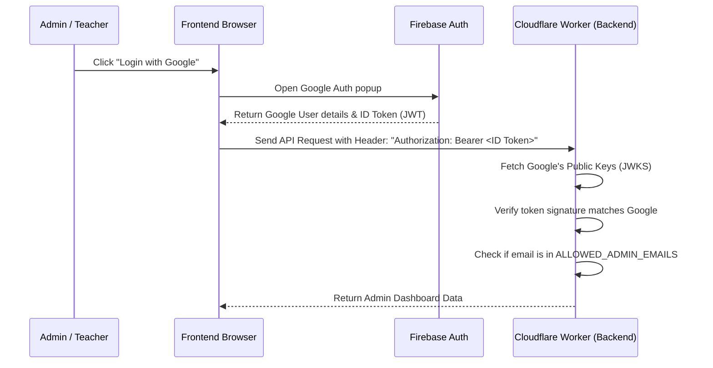

# ShikshaSahayak – Simplified Backend Guide

This guide explains how ShikshaSahayak's backend operates in simple, plain English. 

---

## 1. High-Level Concept: "Serverless"

Unlike a traditional web app, ShikshaSahayak does not run on a persistent, 24/7 server (like Node.js on AWS EC2). Instead, it runs on **Cloudflare Pages** and **Cloudflare Workers**. 

When a user requests a page or clicks a button, Cloudflare spins up a tiny virtual container (a "Worker") instantly, runs the backend script for a split second to fetch or save data, and immediately shuts it down. This makes the backend extremely fast, cheap, and automatically scalable.

---

## 2. Where is the Backend Code?

All backend API routes live inside the [functions/](file:///d:/Programming/ShikshaSahayak%20-%20V2/functions/) directory at the root of the project. 

Cloudflare uses **folder-based routing**. The path of a file under the `functions/` folder matches its URL endpoint.

### Examples:
*   `functions/api/active-popup.ts` ➔ `/api/active-popup`
*   `functions/api/admin/announcements/index.ts` ➔ `/api/admin/announcements`
*   `functions/api/teacher/classes/[id].ts` ➔ `/api/teacher/classes/:id` (where `[id]` is a dynamic variable, like a class ID)

---

## 3. Where is Data Stored?

We use two types of storage provided by Cloudflare:

### A. SQL Databases: Cloudflare D1
We have two fast, relational SQL databases:
1.  **`DB` (Main Database):** Stores catalog metadata (universities, branches, subjects, study materials), blogs, notices, and popup configurations. Its schema is defined in [schema.sql](file:///d:/Programming/ShikshaSahayak%20-%20V2/schema.sql).
2.  **`ASSESSMENT_DB` (LMS Database):** Stores classroom information, grades, quizzes, attendance, student profiles, and submissions. Its schema is defined in [migrations-assessment/0004_teacher_dashboard_schema.sql](file:///d:/Programming/ShikshaSahayak%20-%20V2/migrations-assessment/0004_teacher_dashboard_schema.sql).

### B. File Storage: Cloudflare R2
*   **What it is:** Similar to Amazon S3. It is designed to store heavy files (like PDF syllabus documents or note sheets).
*   **How we use it:** Instead of storing PDFs inside the SQL database (which is slow and expensive), we upload the PDF to R2. We then store the **R2 key** (the unique path to the file, e.g. `materials/maths_unit_1.pdf`) in the D1 database.

---

## 4. How the Backend is Secured (Authentication)

We use **Firebase Authentication** on the frontend, combined with a signature checker on the backend:



1.  **Frontend Authentication:** The user clicks "Login with Google". The frontend talks to Firebase and receives a secure **ID Token** (a JWT token digitally signed by Google).
2.  **Backend Verification:** For every request that needs security, the frontend sends this token in the header: `Authorization: Bearer <token>`.
3.  **Google JWKS Verification:** The Cloudflare Worker backend receives the token, fetches Google's public signature certificates (`https://www.googleapis.com/service-accounts/v1/jwk/securetoken...`), and verifies that the token was actually signed by Google and has not expired.
4.  **Admin Check:** Finally, the backend checks if the authenticated email is listed in `ALLOWED_ADMIN_EMAILS` (defined in [auth.ts](file:///d:/Programming/ShikshaSahayak%20-%20V2/functions/lib/auth.ts)).

---

## 5. Step-by-Step Data Flow Examples

### Example A: Fetching Announcements (Notice Board)
1.  **Request:** The user opens the home page. The frontend calls `/api/admin/announcements`.
2.  **Route Match:** Cloudflare routes the request to [functions/api/admin/announcements/index.ts](file:///d:/Programming/ShikshaSahayak%20-%20V2/functions/api/admin/announcements/index.ts).
3.  **Database Query:** The worker runs:
    ```sql
    SELECT * FROM announcements ORDER BY created_at DESC;
    ```
4.  **Response:** The worker converts the SQL results to JSON and sends it back to the browser, which renders the notice timeline.

### Example B: Uploading Study Notes
1.  **Upload:** An authorized admin uploads a note PDF file.
2.  **R2 Save:** The file is sent to the worker, which uploads the binary PDF stream to the **Cloudflare R2 Bucket** under a structured path like `materials/{material_id}/v1/notes.pdf`.
3.  **D1 Record:** After the file is safely stored in R2, the worker inserts a record into the D1 SQL `documents` and `document_files` tables, linking the note details with its R2 storage key.
