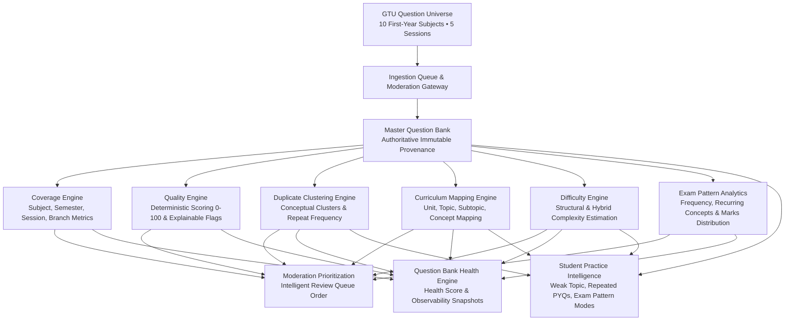

# Phase 10: GTU Question Bank Intelligence, Coverage & Quality Engine
**ShikshaSahayak 2.0 Academic Engine Documentation**
*Date: August 2026* | *Branch: `2.0`*

---

## 1. Overview & Vision

Phase 10 evolves ShikshaSahayak from a system that *collects and moderates* GTU questions into an academic intelligence platform that **understands the historical GTU question universe**.

---

## 2. Core Architectural Pillars

### A. Historical Coverage Engine
- **Granular Coverage**: Deterministic breakdown across 10 First-Year subjects, 5 historical sessions (`W2024`, `S2024`, `W2023`, `S2023`, `W2022`), 2 academic semesters, and 13 engineering branches.
- **Pipeline Metric Aggregation**: Tracks discovered papers, completed papers, failed papers, total extracted questions, staged queue items, verified questions, rejected items, and retry backlogs.

### B. Question Quality Engine
- **Deterministic 0–100 Score**: Computes structural completeness, formula syntax, option validity, and provenance integrity.
- **Explainable Quality Flags**:
  - `MATH_FORMAT_VALID`
  - `PROVENANCE_COMPLETE`
  - `OPTIONS_COMPLETE`
  - `NO_PLACEHOLDER`
  - `LOW_DUPLICATE_RISK` / `HIGH_DUPLICATE_RISK`
  - `OCR_ARTIFACTS_FLAG`
  - `POOR_EXPLANATION`
  - `MISSING_TOPIC`
  - `DESCRIPTIVE_PRESERVED`
- **Moderation Non-Bypass Guarantee**: Quality scores strictly inform reviewer priority and **never auto-approve** or publish questions directly to students.

### C. Conceptual Duplicate Clustering & Repeat Frequency
- **Provenance Retention**: When a question appears repeatedly across sessions (e.g. `W2022 Q.3(a)`, `S2023 Q.2(b)`, `W2024 Q.4(a)`), each occurrence maintains its original exam, year, session, and paper metadata.
- **Cluster Hierarchy**: Linked via `question_duplicate_clusters` and `question_duplicate_cluster_members`.
- **Repeat Frequency Bands**:
  - `VERY_HIGH_REPEAT` ($\ge 4$ appearances)
  - `HIGH_REPEAT` ($3$ appearances)
  - `MEDIUM_REPEAT` ($2$ appearances)
  - `UNIQUE` ($1$ appearance)

### D. Curriculum & Topic Mapping
- **Deterministic Topic Hierarchy**: Maps questions to `Subject` $\to$ `Unit` $\to$ `Topic` $\to$ `Subtopic` $\to$ `Concept Tags`.
- **Confidence Tiers**: `AUTO_MAPPED` ($\ge 0.75$), `REVIEW_REQUIRED` ($< 0.75$), `UNMAPPED` ($0.0$).
- **No Hallucinations**: Uses rule-based keyword anchors across engineering subjects rather than unanchored generative AI text.

### E. Difficulty Intelligence
- **Structural Complexity Signals**: LaTeX math expressions, C programming code blocks, multi-part sub-questions, and GTU marks allocations ($1\text{M}, 3\text{M}, 4\text{M}, 7\text{M}$).
- **Difficulty Tiers**: `EASY`, `MEDIUM`, `HARD`, `VERY_HARD` with explicit confidence ratings and provenance sources (`EXPLICIT`, `INFERRED`, `CALCULATED`).

### F. Exam Pattern Intelligence
- Aggregates recurring concepts, unit representations, question type frequencies, and marks distributions per subject to provide actionable academic insights for students and faculty.

### G. Moderation Prioritization
- Reviewers receive a prioritized queue ordered by quality score, repeat frequency importance, and user issue flags (`CRITICAL`, `HIGH`, `NORMAL`, `LOW`).

### H. Student Practice Intelligence
- Powers personalized practice modes:
  - `WEAK_TOPIC`
  - `REPEATED_PYQ`
  - `REVISION`
  - `EXAM_PATTERN`
  - `DIFFICULTY_PROGRESSIVE`
  - `MIXED_PRACTICE`
- **Security Invariant**: Strictly filters `verification_status = 'verified'` and shields answer keys, explanations, and internal metadata prior to submission.

---

## 3. Database Schema (Migration 079)

- `question_duplicate_clusters`
- `question_duplicate_cluster_members`
- `question_curriculum_mappings`
- `question_difficulty_profiles`
- `question_bank_health_snapshots`

---

## 4. Centralized Safety & Ingestion Limits

| Safety Invariant | Enforced Constant / Limit | Purpose |
|---|---|---|
| Max Papers per Ingestion Run | `MAX_PAPERS_PER_INGESTION_RUN = 20` | Worker CPU & memory execution bound |
| Max Questions per Batch | `MAX_QUESTIONS_PER_BATCH = 100` | Staging queue throttling |
| Max PDF Size | `MAX_PDF_SIZE_BYTES = 15 MB` | Prevents Worker Out-Of-Memory (OOM) |
| Max Page Count | `MAX_PDF_PAGE_COUNT = 25` | Prevents parsing loops on textbooks |
| Max Extracted Text | `MAX_EXTRACTED_TEXT_BYTES = 500 KB` | Memory buffer guard |
| Max Concurrency | `CONCURRENT_PAPER_FETCH_LIMIT = 3` | Subrequest rate-limit protection |
| Max Retry Count | `MAX_RETRY_COUNT = 3` | Prevents infinite retry storms on failed URLs |
